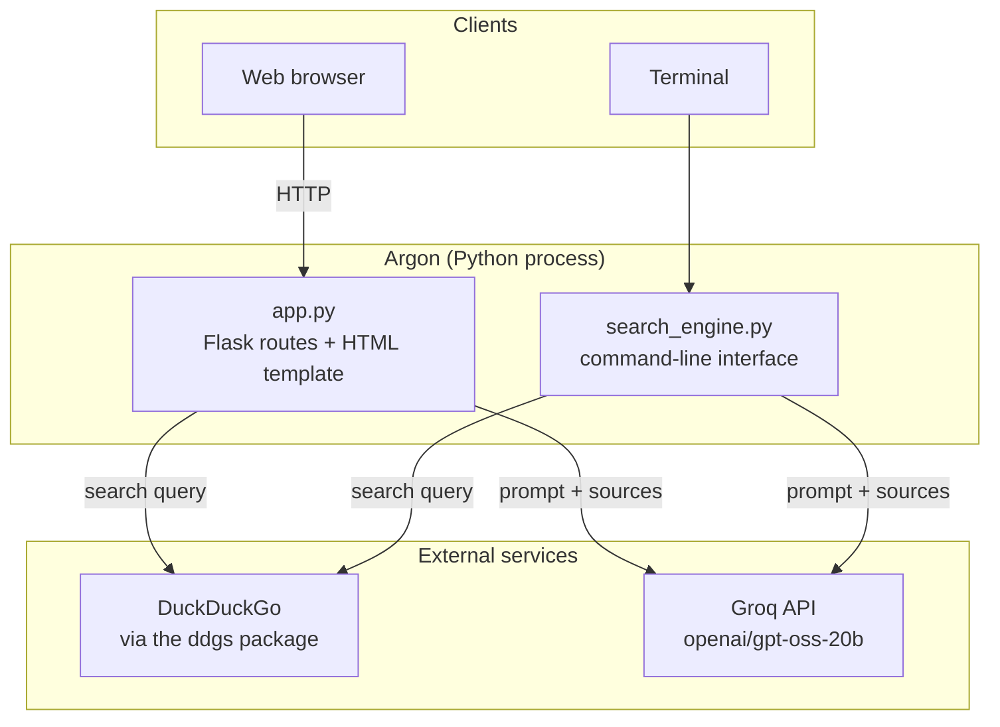
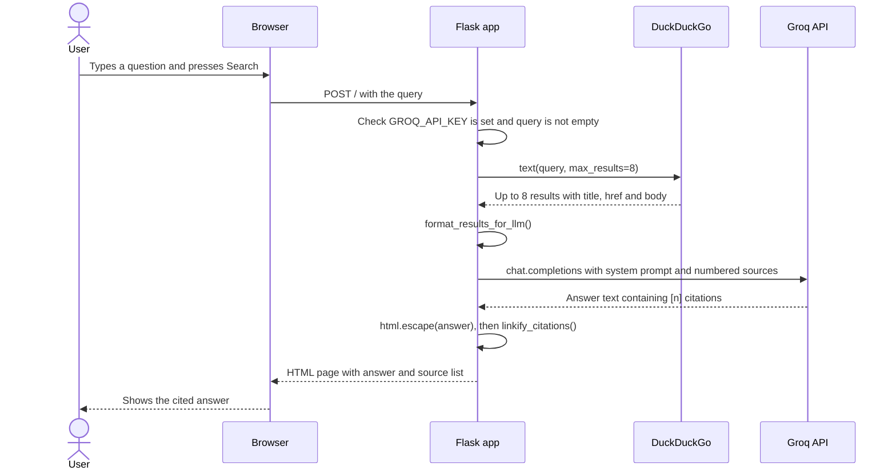
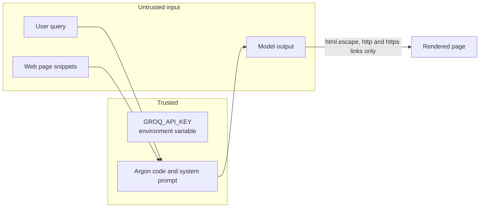
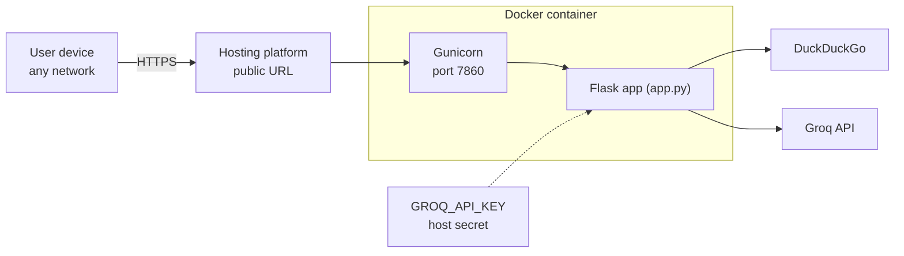

# Argon: System Architecture

This document describes how Argon is built, why it is built that way, and where its limits are. It matches the code in `app.py` and `search_engine.py`.

## 1. Overview

Argon is a **retrieval-augmented answering tool**. For each question it:

1. **Retrieves** live web results (title, URL, snippet) from DuckDuckGo.
2. **Grounds** an LLM on those results by putting them in the prompt as numbered sources.
3. **Generates** a short answer that cites sources as `[n]`.
4. **Presents** the answer with each `[n]` linked to its source page.

It is **stateless**: no database, no sessions, no stored history. Every request is independent.

### Goals

- Free to run end to end (no search API key, no card).
- Answers that can be checked: every claim points to a source.
- Small enough to read and explain in one sitting.

### Non-goals (for now)

- Reading full web pages (only snippets are used).
- Conversation memory or multi-turn follow-ups.
- Heavy traffic or production-scale throughput.

## 2. System context



Both entry points run the same pipeline. The only difference is presentation: the web app renders HTML with clickable citations, the CLI prints plain text.

## 3. Components

| Component | File | Responsibility |
|---|---|---|
| Web server | `app.py` | One route, `/` (GET shows the form, POST runs a search). Validates input, calls the pipeline, renders the page. |
| UI template | `PAGE_TEMPLATE` in `app.py` | Gothic-themed HTML/CSS served with `render_template_string`. No JavaScript and no build step. |
| Search | `web_search()` | Calls DuckDuckGo through `ddgs` and normalizes each hit to `{title, link, snippet}`. |
| Context builder | `format_results_for_llm()` | Turns the hits into a numbered text block: `[1] Title / URL / Snippet`. |
| LLM step | `synthesize_answer()` | Sends the system prompt plus the query and sources to Groq and returns the model's text. |
| Citation linker | `linkify_citations()` (web only) | Replaces each `[n]` with a link to the n-th source. Only `http(s)` URLs are linked. |
| CLI | `search_engine.py` | Same pipeline with `check_config()`, an interactive loop and plain-text output. |

## 4. Request lifecycle



Latency is the sum of the DuckDuckGo call and the Groq call. There is no caching, so the same question runs the full pipeline each time.

## 5. Data and prompt contract

**Search result** (internal dict):

```python
{"title": str, "link": str, "snippet": str}
```

**Context block** sent to the model (one entry per result, numbered from 1):

```
[1] <title>
URL: <link>
Snippet: <snippet>
```

**System prompt rules** (in `synthesize_answer()`):

1. Answer using **only** the provided results.
2. Cite inline with bracketed numbers that match the list, written exactly as `[1]`.
3. If results conflict, say so.
4. If the results don't contain enough information, say so instead of guessing.
5. Keep it concise and do not invent sources or facts.

Numbering the sources is what makes the citations verifiable: the number in the answer maps directly to an entry in the list, which maps to a URL.

## 6. Design decisions

| Decision | Choice | Why | Trade-off |
|---|---|---|---|
| Search provider | DuckDuckGo via `ddgs` | Free, no key, no billing. Google's Custom Search JSON API is not open to new customers. | No official API, so heavy use may be rate-limited and results can vary. |
| LLM provider | Groq free tier | Free, fast, simple API. | Rate-limited. The models available differ by account and change over time, so `MODEL` may need updating. |
| Grounding | Snippets only | Keeps each request fast and cheap, and the prompt small. | The model can't see details that are not in the snippets. |
| Framework | Flask, single file | Easy to read, runs anywhere, no build tooling. | The HTML template lives inside `app.py`. |
| State | None | Nothing to store, secure or migrate. | No history, no follow-up questions. |
| Citations | Model writes `[n]`, server links them | Simple, and the links always point at real search results. | If the model cites a number that doesn't exist, it is left as plain text. |
| Code layout | CLI and web app each contain the pipeline | Each file runs on its own. | The search and prompt code is duplicated. A shared module is on the roadmap. |

## 7. Security and trust boundaries



| Risk | Mitigation |
|---|---|
| API key leaks | The key is read from an environment variable, never written in code. `.gitignore` excludes `.env` files. A leaked key should be revoked and replaced. |
| HTML or script injection through model output | The answer is passed through `html.escape()` before the citation links are added, so nothing the model returns is treated as markup. |
| Unsafe link targets | Citation links are only created for URLs starting with `http://` or `https://`, and the URL is escaped inside the attribute. Sources in the list are escaped by Jinja's autoescaping. |
| Prompt injection from web pages | Snippets are untrusted text that can try to steer the model. The prompt tells it to answer only from the sources, and Argon has no tools or actions, so the worst case is a wrong or odd answer. |
| Error details shown to users | On failure the page shows `Something went wrong: <error>`. This is helpful while developing but should be replaced with a generic message for a public site. |

## 8. Error handling

| Situation | Behavior |
|---|---|
| `GROQ_API_KEY` missing | Web: error banner on search, plus a warning at startup. CLI: prints instructions and exits. |
| Empty query | Web: "Please enter a search query." |
| No search results | "No search results found for that query." |
| Search or LLM call fails (network, rate limit, wrong model name) | The exception text is shown instead of an answer. |
| Model cites a source number that doesn't exist | The `[n]` stays as plain text. |

## 9. Performance and limits

- One DuckDuckGo request and one Groq request per search, run one after the other.
- Up to 8 results per query and `max_tokens=1500` on the answer.
- No caching, so repeated questions repeat the work.
- Groq's free tier rate limits and DuckDuckGo's unofficial access are the main ceilings.
- Under Gunicorn the worker timeout is set to 60 seconds to allow for slow upstream calls.

## 10. Deployment architecture



The `Dockerfile` builds a Python 3.11 image, installs `requirements.txt` plus Gunicorn, and serves `app:app` on port 7860. The API key is supplied by the host as a secret and never stored in the image or the repository. Hosting options are covered in [DEPLOYMENT.md](DEPLOYMENT.md).

An important constraint: the host must allow **outbound internet access** to DuckDuckGo and the Groq API. Some free tiers restrict this (see DEPLOYMENT.md).

## 11. Future work

- **Full-page reading:** fetch the top pages and give the model real text, not just snippets.
- **Streaming:** show the answer as it is generated.
- **Follow-ups:** keep a short conversation history per session.
- **Caching:** store recent queries to save time and rate-limit budget.
- **Refactor:** move search, prompt and formatting into one shared module used by both the CLI and the web app.
- **Tests:** unit tests for `format_results_for_llm()` and `linkify_citations()`, with the search and LLM calls mocked.
