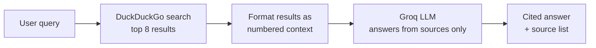

<h1 align="center">Argon</h1>

<p align="center">
  <em>An AI search engine that reads the web for you and answers with sources.</em>
</p>

<p align="center">
  
  
  
  
  
  
</p>

<!-- Add a screenshot of the web UI: save it as screenshot.png in this repo, then uncomment:
<p align="center"></p>
-->

<!-- After deploying, add your live link here, e.g.:
<p align="center"><a href="https://YOUR-LIVE-LINK"><b>Live demo</b></a></p>
-->

---

## What is Argon?

Argon is a small retrieval-augmented search tool. You ask a question, it pulls live results from the web, and an LLM reads those results and writes a short answer with numbered citations that link back to the original pages.

It runs as a **command-line tool** or as a **dark, gothic-themed web app**, and the whole stack is free: no search API key, no billing account, no credit card.

## Features

- **Live web results** from DuckDuckGo, no search API key needed
- **Cited answers**: every claim is tagged `[1]`, `[2]`, ... and the numbers are clickable links to the source
- **Honest when unsure**: the model is instructed to say so when the results don't contain the answer, instead of guessing
- **Two interfaces**: a CLI (`search_engine.py`) and a Flask web UI (`app.py`)
- **Custom UI**: animated watery gradient background, Cormorant Garamond headings, monospace citation chips
- **Safe rendering**: model output is HTML-escaped and only `http(s)` links are generated
- **Free to run**: DuckDuckGo plus Groq's free tier

## How it works



1. `web_search()` queries DuckDuckGo through the `ddgs` package and returns titles, URLs and snippets.
2. `format_results_for_llm()` turns them into a numbered context block.
3. `synthesize_answer()` sends the query and context to a Groq-hosted model with a system prompt that says: answer only from these results, cite with `[n]`, flag conflicts, admit gaps.
4. In the web app, the answer is HTML-escaped, then `linkify_citations()` converts each `[n]` into a link to the matching source.

The full design, including a request sequence diagram, design decisions and the security model, is in [ARCHITECTURE.md](ARCHITECTURE.md).

## Tech stack

| Layer | Tool |
|---|---|
| Language | Python 3.10+ |
| Web framework | Flask |
| Search | DuckDuckGo via [`ddgs`](https://pypi.org/project/ddgs/) |
| LLM | [Groq](https://console.groq.com) API (free tier), default model `openai/gpt-oss-20b` |
| Front end | Plain HTML/CSS served from a Flask template |
| Container | Docker (optional, for hosts such as Hugging Face Spaces) |

## Getting started

### 1. Clone and install

```bash
git clone https://github.com/manyaagrawal208/argon-search-engine.git
cd argon-search-engine
pip install -r requirements.txt
```

### 2. Get a free Groq API key

Create one at [console.groq.com/keys](https://console.groq.com/keys). No card is required.

### 3. Set the key as an environment variable

**Windows (PowerShell)**
```powershell
$env:GROQ_API_KEY="your-key-here"
```

**macOS / Linux**
```bash
export GROQ_API_KEY="your-key-here"
```

Set the key **before** starting the app, in the same terminal window.

### 4. Run it

**Web app**
```bash
python app.py
```
local: Then open <http://127.0.0.1:5000>. The server stops when you close the terminal.

**Command line**
```bash
python search_engine.py "what is the capital of France"
```
Run it with no argument for an interactive prompt.

## Project structure

```
argon-search-engine/
├── app.py                      # Flask web app + Argon UI
├── search_engine.py            # CLI version of the same pipeline
├── requirements.txt            # ddgs, groq, flask
├── Dockerfile                  # container image for Docker-based hosts
├── .dockerignore
├── .gitignore                  # keeps keys and caches out of git
├── LICENSE
├── docs/
│   ├── ARCHITECTURE.md         # system design, diagrams, decisions
│   └── DEPLOYMENT.md           # local, Hugging Face Spaces, Render, notes
└── deploy/
    └── huggingface/
        └── README.md           # front matter file used only on a Hugging Face Space
```

## Configuration

| What | Where | Default |
|---|---|---|
| Groq API key | `GROQ_API_KEY` environment variable | none (required) |
| Model | `MODEL` constant at the top of `app.py` and `search_engine.py` | `openai/gpt-oss-20b` |
| Results per query | `num_results` in `index()` (`app.py`) / `run_query()` (`search_engine.py`) | 8 |
| Answer style and rules | `system_prompt` in `synthesize_answer()` | cite-only-from-sources |
| Bind address | `HOST` environment variable | `127.0.0.1` |
| Port | `PORT` environment variable | `5000` |
| Auto-reload for development | `FLASK_DEBUG=1` | off |

Groq's available models differ by account and change over time. If you get a `model_not_found` error, list what your key can use and update `MODEL`:

```bash
python -c "from groq import Groq; import os; print([m.id for m in Groq(api_key=os.environ['GROQ_API_KEY']).models.list().data])"
```

## Deployment

Running `python app.py` only serves the app on your own computer. To get a link that works from any device and network, deploy it. [DEPLOYMENT.md](DEPLOYMENT.md) has step-by-step instructions for Hugging Face Spaces (free, no card, uses the included `Dockerfile`) and notes on Render and PythonAnywhere.

## Security

- The API key is read from an environment variable and is never written into the code. `.gitignore` blocks `.env` files. If a key is ever exposed, revoke it in the Groq console and create a new one.
- Model output is HTML-escaped before it is shown, so text coming back from web pages can't inject markup into the page, and citation links are only created for `http` and `https` URLs.
- Web content is untrusted input to the model. Argon only returns text and takes no actions, which limits what a prompt-injection attempt can do.

## Limitations

- DuckDuckGo has no official API. `ddgs` is fine for personal use, but heavy traffic may get rate-limited.
- The model only sees search **snippets**, not full pages, so very specific or very recent facts may not come through.
- Groq's free tier is rate-limited.
- The Flask development server is used when running `python app.py`. The Dockerfile runs the app under Gunicorn instead.
- Each question is independent: there is no conversation memory or history.

## Roadmap

- [ ] Fetch and read full page text, not just snippets
- [ ] Stream the answer as it is generated
- [ ] Follow-up questions with conversation memory
- [ ] Search history
- [ ] Share the search and prompt code between the CLI and the web app
- [ ] Public deployment

## Documentation

- [System architecture](ARCHITECTURE.md)
- [Deployment guide](DEPLOYMENT.md)

## License

Released under the [MIT License](LICENSE).

## Author

Built by **Manya Agrawal**.
